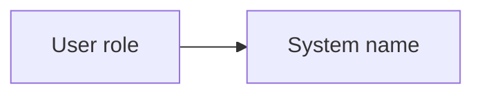

# System name

Architecture narrative for the audience

---

# Act 1: Setup

- The problem and why now
- Who is involved

---

# Act 2: Confrontation

| Characteristic | Target |
| --- | --- |
| Characteristic | Target |

- The alternatives and their trade-offs

---

# Act 3: Resolution

- The architecture
- D1: decision, and the alternative it beat
- Top risks and their mitigation
