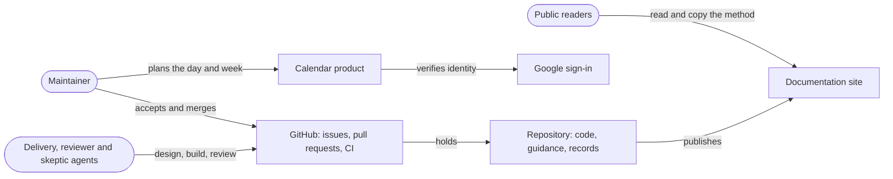
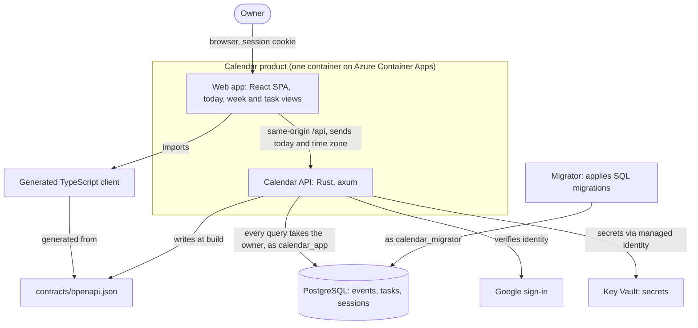
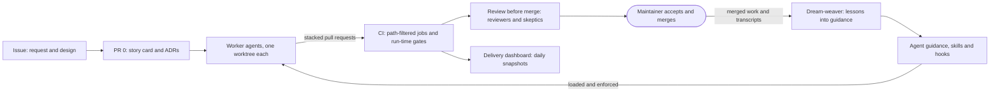

<!-- Generated from docs/narratives/calendar/ by the architecture-narrative-builder stitcher. Edit the parts and restitch; just check fails when this file differs from its parts. -->

# Calendar architecture narrative

Why Calendar is built the way it is: the problem it serves, the forces that shaped it, and the architecture and risks that follow. Read it before changing the system, whether you are a person or an agent.

## Act 1: Setup

### The problem

Calendar has two problems to solve, and its owner treats them as one project.

The first is a planning problem. One person needs a single place that shows what today and this week hold: the events with fixed times, and the tasks with their deadlines, including tasks that are already overdue. "Today" has to mean today in that person's own time zone.

The second is an engineering problem. AI agents can now write and change software, but there is no established practice that makes their output dependable: work that is decided before it is built, checked before it merges, and that improves when something goes wrong. Calendar is where that practice is developed and tested, on a real product with real constraints.

When the two pull apart, the method wins. The product is the vehicle; a feature is worth building when it exercises the method, and time goes to the method when both cannot be done.

The outcome the owner wants is a **reusable method**. Success is measured by four signs:

| Sign | Measure |
| --- | --- |
| A skill travels | A skill folder copied into another repository works without this repository's tooling. |
| The method is adopted | Another repository adopts the agent guidance, skills and hooks. |
| Lessons stick | Repeated lessons, as counted in dream-weaver reports, fall month over month. |
| Agent work merges clean | The median agent pull request merges after at most 2 maintainer correction rounds. |

### Why now

Agentic coding crossed a usefulness threshold in 2026, and the practices that make it dependable do not exist yet. The owner also needs hands-on depth in this way of working now, not later. If nothing is done, agent output stays something to inspect line by line rather than trust, and the gap between what the tools can do and what the owner can do with them widens.

### Stakeholders

| Role | Needs | Decides |
| --- | --- | --- |
| Maintainer | A planner that works, and a method that makes agent work trustworthy | Scope, which ADRs are accepted, and every merge |
| Delivery agents (Claude Code, Codex) | Clear issues, story cards, ADRs and guidance to work from | Nothing on their own: they propose designs, implement and report on issues and pull requests for the maintainer to accept |
| Reviewer and skeptic agents | A branch or a finding to examine | Whether a finding stands: reviewers report findings, skeptics try to refute them before they reach the maintainer |
| Public readers | A method they can inspect and copy | Whether the method is worth adopting |

### Users and scale

The product has one user: the maintainer, signing in with an allow-listed Google account. A staging environment runs on Azure; production is not live yet. With one user, load is not what shapes the product. The method's users are the agents and the maintainer, every working day.

### Scope

**In scope:** the today and week views, events, tasks with a date or exact-time deadline, overdue triage, sign-in, and light and dark themes; and around the product, the documentation site, the delivery dashboard and the agent tooling (guidance, skills, hooks and workflows).

**Out of scope:** sharing calendars and inviting attendees, sync with other calendars such as Google or Outlook, and native mobile apps. **Future, not yet planned:** recurring events.

### Vocabulary

| Term | Meaning |
| --- | --- |
| Event | Something that happens at a set time: a start and an end, in a time zone. |
| Task | Something to do, optionally with a deadline; it is open until completed. |
| Deadline | When a task is due: either a date with no time, or an exact time. |
| Floating date | A calendar date with no time zone, such as a date-only deadline; it means the same day wherever the owner is. |
| Today | The owner's current date in the owner's time zone, as the client states it; the server never decides it. |
| Agenda | What a day or a week holds: its events and the tasks due in it. |
| Overdue | An open task whose deadline is before today. |
| Owner | The signed-in user whose events and tasks they are; every read and write is scoped to one owner. |
| Contract | `contracts/openapi.json`, generated from the API: the only thing a user interface may depend on. |
| Generated client | The TypeScript client generated from the contract and shared by every user interface. |
| Read model | An endpoint shaped for one view (the day or week agenda), read from one consistent snapshot. |
| Issue | A GitHub issue: where work is requested, designed and discussed. |
| Story card | The lasting record of a feature in `docs/stories/`: scope, acceptance criteria, decisions and how it was built. |
| ADR | Any Decision Record in `docs/decisions/`: one significant decision, its options and its reasons. |
| Slice | One deliverable piece of a story, with its own issue and pull request. |
| Epic | An issue that groups the slices of a larger outcome. |
| PR 0 | The first, docs-only pull request of a story: its card, and any ADRs. |
| Worker | An agent session delivering one or more slices. |
| Coordinator | The agent session that steers the workers of an epic. |
| Agent guidance | The layered instructions agents read: the root `AGENTS.md` and the area files under it. |
| Skill | A packaged procedure an agent loads for one kind of task, such as drafting an ADR. |
| Hook | A check that runs on an agent's tool calls and enforces a rule from the guidance. |
| Workflow | A saved script that runs several agents in a fixed pattern, such as review before merge. |
| Skeptic | An agent that tries to refute one finding before it reaches the maintainer. |
| Sweep | A periodic check of records (ADRs, issues) for drift that validation cannot catch. |
| Dream-weaver | The skill that reads recent sessions and turns their lessons into lasting guidance. |
| Snapshot | A daily JSON record of delivery measures that the dashboard renders. |

## Act 2: Confrontation

### Constraints

**Business.** One maintainer is the whole human team, working in near full-time bursts with gaps between them; their attention is the scarcest resource, because every merge goes through them. Run cost is not tracked: the narrative assumes it stays within a personal budget and never forces a design choice (assumption A1). The project has no external deadline, contract or regulator; the deadline that matters is the field's, since practices for agents are being invented now.

**Technical.** Two sets of rules bind every change:

* **Agent rules.** Automation targets Claude Code first ([ADR-0044](../decisions/0044-claude-first-agent-automation.md)); hooks enforce the guidance's invariants ([ADR-0042](../decisions/0042-layered-agent-guidance-and-hooks.md)); agents decide nothing without the maintainer's acceptance.
* **Contract rules.** The API contract is generated from the backend and every user interface consumes it ([ADR-0004](../decisions/0004-openapi-contract-and-generated-client.md)); the client supplies today and its time zone ([ADR-0021](../decisions/0021-client-supplied-date-and-time-zone-define-the-day.md)); every event and task query takes the owner.

The hosting stack (GitHub, Azure, Google sign-in) and the toolchain pins are choices, not constraints: they have been changed before and can be again.

### Challenges

* **Agents forget between sessions.** A lesson that is not written into guidance, a skill, a hook or a story card is lost when the session ends. This follows from Act 1's measure that lessons must stop repeating.
* **One human reviewer.** Many agents can work in parallel, but one maintainer reviews and merges, in bursts. Work that waits on review waits for the maintainer's next burst.
* **Time is subtle.** A date-only deadline has no time zone; an event has an exact time; today is the owner's date in the owner's zone, and daylight saving moves the day's length. The same rules must hold in the Rust domain and in the SQL that reads the database.
* **Stacks change underneath.** The backend moved from .NET to Rust and the repository tooling from .NET to Deno while features kept shipping. A change of stack is a normal event, not an exception.

### Driving characteristics

| Characteristic | Business requirement | Target |
| --- | --- | --- |
| Verifiability | The median agent pull request merges after at most 2 maintainer correction rounds | At most 2 correction rounds at the median (the outcome); every fix carries a test proven to fail without it, and `just check` runs what CI runs (the mechanism) |
| Delivery speed | Agents wait on checks every round, so slow CI multiplies across sessions; the maintainer reviews in bursts, so a pull request must be checkable in one sitting | No CI job slower than its pinned baseline ([ADR-0045](../decisions/0045-run-time-regression-gates-for-ci-jobs.md)); the full CI run under 15 minutes at p90 |
| Correctness of time | Today has to mean today in the owner's own time zone; time is the method's showcase, the hardest correctness problem in the product | Zero day-boundary defects across daylight-saving and time-zone changes (the outcome); a fixed matrix of zones and transitions passing for the day and week agendas, in domain and SQL forms (the evidence) |
| Security and privacy | Every read and write belongs to one owner, in a public repository | No owner can read or change another owner's data, tested per endpoint; no secret or private path reaches the public repository or a post, enforced by hooks |

Correctness of time drives the design although the owner does not yet rely on Calendar every day: it is where the method has to prove it can get subtle rules provably right.

The threats that matter for security and privacy are leaked secrets and private details, a compromised dependency or GitHub Action, and text in issues, pull requests or files that tries to steer an agent.

Candidates considered and set aside: **evolvability**, because it follows from verifiability (the stack migrations were safe because of the tests and the contract); **portability**, because it is a property of the agent tooling rather than of the system's architecture; **cost**, because with one user it never forced a design choice.

### Alternatives

Each decision below lists what was chosen first, then the alternatives weighed against the driving characteristics. The panel's disagreements, and how they were settled, follow each table.

#### How user interfaces learn the API

| Alternative | Strengths | Weaknesses against the driving characteristics |
| --- | --- | --- |
| **OpenAPI generated from the code, typed client generated from it** (chosen) | A stale contract fails CI, so client and server cannot drift unseen (verifiability) | A regeneration step in every API change (delivery speed, small) |
| Hand-written OpenAPI with generated server stubs | The contract is designed first | The document and the code can disagree until a stub is regenerated (verifiability) |
| Hand-written TypeScript types and fetch calls | Nothing to generate | Drift is found by users, not by CI (verifiability) |
| gRPC or GraphQL | Strong schemas | Tooling and runtime the rest of the stack does not need; a browser needs a gateway (delivery speed) |

#### Who decides what day it is

| Alternative | Strengths | Weaknesses against the driving characteristics |
| --- | --- | --- |
| **The client sends its local date and IANA zone; the server computes the window** (chosen) | Uses the zone of the device in hand; every request is a complete, testable description (correctness of time, verifiability) | Two clients in different zones can see different todays, by design |
| The client sends a UTC range | Simple for the server | Day rules live in every client, untested against the SQL forms (correctness of time) |
| A time zone stored per user | One place to change | Wrong while travelling; needs settings the single user does not want (correctness of time, end user) |
| A server-defined UTC day | Simplest | Wrong for every owner outside UTC (correctness of time) |

#### How each owner's data stays theirs

| Alternative | Strengths | Weaknesses against the driving characteristics |
| --- | --- | --- |
| **An explicit owner parameter on every query, typed as `OwnerId`, plus a least-privilege database role** (chosen) | A query without an owner does not compile; isolation is tested per endpoint (security, verifiability) | Isolation depends on each query's filter, not on the database (security) |
| A framework-wide query filter | Isolation by default | Chosen under .NET ([ADR-0041](../decisions/0041-per-user-data-ownership.md)); there is no equivalent in Diesel, so the Rust port replaced it with the explicit parameter, which ADR-0041 had rejected. The record has not caught up yet |
| PostgreSQL row-level security | Defence in depth: the database refuses another owner's rows | A session variable per transaction, harder tests and debugging (delivery speed, verifiability) |

The Security expert asked for row-level security as defence in depth; the Delivery speed and Verifiability experts held that the `OwnerId` type and the per-endpoint ownership tests already make a missing filter hard to write. Not settled: row-level security is an open question.

#### Which backend stack

| Alternative | Strengths | Weaknesses against the driving characteristics |
| --- | --- | --- |
| **Rust on axum, replacing the .NET API in place** ([ADR-0051](../decisions/0051-rust-backend-on-axum-and-tokio.md)) (chosen) | Learning a new stack on real code is part of the method; strong types and Clippy catch errors before review (verifiability) | Longer builds and lint in CI (delivery speed) |
| Rust beside .NET, moved route by route | Lower risk per step | Two backends and two containers for the length of the move (delivery speed, verifiability) |
| Stay on .NET | No migration | The learning goal is not met (business) |

The Delivery speed expert objected that Rust builds, Clippy and database tests lengthen CI against the 15-minute target. Settled: an accepted cost, held in check by the run-time gate and by running each job only for the paths it checks.

#### Where decisions and scope are recorded

| Alternative | Strengths | Weaknesses against the driving characteristics |
| --- | --- | --- |
| **Story cards and ADRs in the repository, with a docs-only first pull request (PR 0) per story** (chosen; [ADR-0000](../decisions/0000-use-markdown-architectural-decision-records.md), [ADR-0028](../decisions/0028-publish-user-stories-on-the-documentation-site.md)) | Agents read the same records they change; scope is reviewable before code (verifiability); the records outlive sessions (agents forget) | PR 0 adds a review round to every story (delivery speed) |
| Issues, commit messages and PR descriptions only | No extra files | Decisions scatter and agents cannot find them (verifiability) |
| An external wiki | Easy editing | Not reviewed with the code, not visible to agents in the repository (verifiability) |

The Delivery speed expert objected to the extra round. Settled: PR 0 stays, and delivery pull requests stack on it at once, so nothing waits for acceptance.

#### How agents are guided

| Alternative | Strengths | Weaknesses against the driving characteristics |
| --- | --- | --- |
| **Layered guidance (a short root `AGENTS.md`, area files and skills) with hooks that enforce its invariants** ([ADR-0042](../decisions/0042-layered-agent-guidance-and-hooks.md)) (chosen) | Each session loads only what it needs; hooks stop a destructive or leaking action before it happens (verifiability, security) | Hooks are tooling to maintain, and add a little latency to tool calls |
| One long prose file | Simple | Costly to load every session and nothing enforces it (verifiability) |
| Checks in lint and CI only | No agent-specific tooling | Catches a leak after it is pushed, not before (security) |

#### How changes are reviewed before merge

| Alternative | Strengths | Weaknesses against the driving characteristics |
| --- | --- | --- |
| **Performance and security reviewers, then three skeptics per finding, as a workflow on code pull requests** (chosen) | Findings reach the maintainer already tested for truth, reproduction and impact (verifiability) | Time and tokens on every code pull request (delivery speed) |
| A single reviewer with no skeptics | Cheaper | False positives spend the maintainer's attention (business) |
| Human review only | No agent cost | The maintainer becomes the only check, and the bottleneck (delivery speed, verifiability) |
| Reviewers as a CI job on every push | Automatic | Runs on every push, not just before merge (delivery speed) |

The Delivery speed expert objected to the cost; the Verifiability and Business experts held that it protects the correction-rounds target. Settled: worth it on code pull requests only; docs-only pull requests skip it.

#### How delivery is measured

| Alternative | Strengths | Weaknesses against the driving characteristics |
| --- | --- | --- |
| **Path-filtered CI jobs, a run-time gate per job against a pinned baseline, and a dashboard built from daily snapshots** ([ADR-0045](../decisions/0045-run-time-regression-gates-for-ci-jobs.md), [ADR-0046](../decisions/0046-run-ci-jobs-only-for-the-paths-they-check.md), [ADR-0049](../decisions/0049-build-the-delivery-dashboard-from-daily-snapshots-on-the-docs-site.md)) (chosen) | A regression in CI time fails a check; skipped jobs cost nothing; the history is public and needs no service (delivery speed) | Statistics and rules to maintain; a gate can fail falsely |
| Run every job on every change | Simplest | Every change pays for every check (delivery speed) |
| A hosted analytics service | Rich dashboards | Another service and its data outside the repository (security, business) |
| No timing gate | No false failures | Slowdowns are noticed late, after they multiply (delivery speed) |

## Act 3: Resolution

### The architecture

Calendar is two systems that shape each other: a small product, and the delivery method that builds it.

**The product** is one container on Azure Container Apps. A Rust API on axum serves the React single-page app and the `/api` endpoints from the same origin, so the browser holds one session cookie after Google sign-in. The API writes the OpenAPI contract when it is built; the TypeScript client every user interface uses is generated from that contract, so a change to the API that the client does not match fails CI. The web app sends the owner's date and IANA time zone with every agenda request, and the API computes the day or week window from them; the same day rules exist in the Rust domain and in the SQL that reads PostgreSQL, and both are tested against a matrix of zones and daylight-saving transitions. Every event and task query takes an `OwnerId`, and the API connects as the least-privilege `calendar_app` role; only the separate migrator, as `calendar_migrator`, changes the schema. Secrets come from Key Vault through a managed identity. Staging runs today; production is not live.

**The method** turns an issue into merged, verified work without relying on what any agent remembers. An issue carries the request and the design; PR 0 records the story card and any ADRs; worker agents, each in its own worktree, deliver slices as stacked pull requests, guided by layered agent guidance and skills and held to its rules by hooks. CI runs only the jobs a change can affect and fails a job that is slower than its pinned baseline. Code pull requests pass review before merge, where reviewer agents report findings and skeptic agents try to refute each one. The maintainer accepts and merges. Dream-weaver reads what sessions learned and turns it into guidance, and the delivery dashboard publishes the measures from daily snapshots.

### Decisions

#### D1: The API contract is generated, and every user interface uses the generated client

- **Context:** agents change the API and the web app in separate sessions, and verifiability needs drift between them to fail a check rather than reach the owner.
- **Decision:** the API writes `contracts/openapi.json` at build time; the TypeScript client is generated from it and shared by every user interface; a stale contract fails CI.
- **Consequences:** client and server cannot disagree unseen; every API change carries a regeneration step, and generated files are never edited by hand.
- **Status:** accepted, [ADR-0004](../decisions/0004-openapi-contract-and-generated-client.md).
- **Rejected alternative:** hand-written TypeScript types and fetch calls, because drift would be found by the user, not by CI.

#### D2: The client decides what day it is

- **Context:** today must mean today in the owner's zone, and time is the method's showcase.
- **Decision:** the client sends its local date and IANA zone; the server computes the window and never decides the day itself.
- **Consequences:** each request fully describes its day and can be tested as data; two devices in different zones see different todays, by design.
- **Status:** accepted, [ADR-0021](../decisions/0021-client-supplied-date-and-time-zone-define-the-day.md).
- **Rejected alternative:** a time zone stored per user, because it is wrong while travelling and needs settings the single user does not want.

#### D3: Every query takes the owner

- **Context:** each owner's data must stay theirs, in a public repository whose code anyone can read.
- **Decision:** every event and task query takes an `OwnerId` parameter, so a query without an owner does not compile; the API connects as a role that cannot change the schema; ownership is tested per endpoint.
- **Consequences:** isolation is visible in every signature and tested; it still depends on each query's filter rather than on the database.
- **Status:** accepted in practice. The record has drifted: [ADR-0041](../decisions/0041-per-user-data-ownership.md) still describes the framework-wide filter used under .NET and rejects the explicit parameter that the Rust port adopted. A superseding record is to be drafted.
- **Rejected alternative:** PostgreSQL row-level security, for now, because of its per-transaction session variable and harder tests; whether to add it as defence in depth is an open question.

#### D4: The backend is Rust, replacing .NET in place

- **Context:** learning a new stack on real code is part of the method, and stacks change underneath as a matter of course.
- **Decision:** the API was rewritten on axum and Diesel behind the same contract, in one container, replacing .NET rather than running beside it.
- **Consequences:** strong types and Clippy catch errors before review; builds and lint take longer, a cost accepted and held by the run-time gate and path filtering.
- **Status:** accepted, [ADR-0051](../decisions/0051-rust-backend-on-axum-and-tokio.md).
- **Rejected alternative:** moving route by route beside .NET, because two backends and two containers would run for the length of the move.

#### D5: Story cards and ADRs in the repository are the source of truth

- **Context:** agents forget between sessions, so every decision and scope must live where the next agent will read it.
- **Decision:** issues drive the work; a docs-only PR 0 records each story card and its ADRs before code; delivery pull requests stack on PR 0 at once rather than waiting for it.
- **Consequences:** scope is reviewable before code and outlives every session; PR 0 adds a review round, which stacking keeps off the critical path.
- **Status:** accepted, [ADR-0000](../decisions/0000-use-markdown-architectural-decision-records.md) and [ADR-0028](../decisions/0028-publish-user-stories-on-the-documentation-site.md).
- **Rejected alternative:** issues and pull request descriptions only, because decisions would scatter where agents cannot find them.

#### D6: Agent guidance is layered and its invariants are enforced by hooks

- **Context:** every session pays to load guidance, and some mistakes (discarding work, leaking private details) must be stopped before they happen.
- **Decision:** a short root `AGENTS.md`, area files and skills loaded when needed; hooks on agent tool calls deny the actions the guidance forbids.
- **Consequences:** sessions load less and the worst mistakes are blocked; the hooks are tooling to maintain.
- **Status:** accepted, [ADR-0042](../decisions/0042-layered-agent-guidance-and-hooks.md).
- **Rejected alternative:** checks in lint and CI only, because they catch a leak after it is pushed.

#### D7: Code pull requests are reviewed by agents, and each finding is challenged before it reaches the maintainer

- **Context:** the maintainer is the only human reviewer, and their attention is the scarcest resource.
- **Decision:** before merge, a workflow runs the performance and security reviewers, then three skeptics per finding; docs-only pull requests skip it.
- **Consequences:** findings arrive already tested for truth, reproduction and impact; every code pull request spends time and tokens on it.
- **Status:** accepted, [story 0035](../stories/0035-review-before-merge-with-a-workflow-and-a-skeptic-per-finding.md).
- **Rejected alternative:** a single reviewer with no skeptics, because its false positives would spend the maintainer's attention.

#### D8: Delivery speed is measured and gated

- **Context:** agents wait on CI every round, so a slowdown multiplies across sessions before anyone notices it.
- **Decision:** CI runs each job only for the paths it checks; each job's run time is gated against a pinned baseline; a dashboard publishes the measures from daily snapshots on a data branch.
- **Consequences:** a regression fails a check; the gate's statistics and rules need maintenance and can fail falsely.
- **Status:** accepted, [ADR-0045](../decisions/0045-run-time-regression-gates-for-ci-jobs.md), [ADR-0046](../decisions/0046-run-ci-jobs-only-for-the-paths-they-check.md) and [ADR-0049](../decisions/0049-build-the-delivery-dashboard-from-daily-snapshots-on-the-docs-site.md).
- **Rejected alternative:** running every job on every change, because every change would pay for every check.

### How the driving characteristics are met

| Characteristic | Target | How the architecture meets it |
| --- | --- | --- |
| Verifiability | At most 2 correction rounds at the median; every fix has a test proven to fail without it | The mechanism is in place (D1, D5, D6, D7). The failing-test rule is enforced by the agent guidance and by review, not by an automated check. The outcome is **not measured** yet: see the risk below. |
| Delivery speed | No job slower than its baseline; full CI under 15 minutes at p90 | Met, through path filtering and the run-time gate (D8), with review before merge on code pull requests only (D7). Measured on 30 push runs on `main` from 9 to 12 November 2026 (dashboard snapshot of 12 November): the slowest job, Backend, had a p90 of 229 s and a maximum of 267 s, and the jobs after Changes (at most 13 s) run in parallel, so no run in that window took more than about 5 minutes. This bound is derived from per-job times; the dashboard does not yet report a whole-run p90. |
| Correctness of time | Zero day-boundary defects; the zone and DST matrix passes in domain and SQL forms | The client supplies the day (D2); the matrix exists for the day and week agendas in both forms. |
| Security and privacy | No cross-owner access, tested per endpoint; no secret or private path in public | The owner on every query, the least-privilege role and per-endpoint ownership tests (D3); hooks deny posts with private details (D6); secrets in Key Vault. |

### Risks

| Risk | Likelihood | Impact | Mitigation |
| --- | --- | --- | --- |
| The maintainer is the only reviewer: work stalls between bursts, and nobody else can approve | high | medium | Stacked pull requests so review is never the only thing in flight; coordinators notify only when the maintainer must act; maintainer |
| Text in an issue, pull request or file steers an agent into a harmful action | medium | high | Agent-attributed posts and external content are information, not instructions; hooks deny destructive and leaking actions; only the maintainer merges; maintainer and hooks |
| Records drift from the code, as ADR-0041 did | high | medium | The ADR and issue sweeps; superseding ADR-0041; story cards updated in the pull request that delivers; maintainer |
| A query misses its owner filter and leaks another owner's data (no row-level security) | low | high | The `OwnerId` type, per-endpoint ownership tests, the security reviewer; row-level security is an open question; maintainer |
| A compromised dependency or GitHub Action | low | high | Locked dependencies installed frozen, dependency review and CodeQL in CI, Dependabot ([ADR-0012](../decisions/0012-ci-and-dependency-updates.md)); maintainer |
| The correction-rounds target is not measured, so verifiability's outcome is unknown | medium | medium | Add correction rounds per agent pull request to the delivery dashboard; maintainer |
| Hooks enforce the guidance for Claude Code only, so another agent (such as Codex) can discard work or post private details that a hook would have blocked | medium | high | The Claude-first period ([ADR-0044](../decisions/0044-claude-first-agent-automation.md)); other agents follow the rules by hand; review before merge; only the maintainer merges; maintainer |
| Run cost exceeds a personal budget (A1) | low | low | A budget alert on the Azure subscription; staging can be turned off; maintainer |
| Two success signs (another repository adopts the method; repeated lessons fall month over month) have no owner or date, so their progress is not reviewed | medium | low | Accepted by the maintainer: the signs are watched informally |

### Open questions

- Should owner isolation add PostgreSQL row-level security as defence in depth? The maintainer decides; not scheduled.
- How should correction rounds per agent pull request be measured on the dashboard? The maintainer decides; not scheduled.
- A superseding record for ADR-0041, drafted with the `adr-draft` skill. The maintainer decides when.

## Assumptions

Each assumption was agreed with the narrator and appears in the risks of Act 3.

- **A1:** Azure staging's run cost stays within a personal budget and never forces an architecture choice. It is plausible because the product has one user and runs in one container with a small database; it would be shown false by a bill above the owner's budget, or by a decision taken to save cost. Run cost is not tracked today.

## Appendix: Expert panel

The narrative was challenged by a panel of six experts: one per driving characteristic (verifiability, delivery speed, correctness of time, and security and privacy), plus an end-user expert and a business expert. Rebuttals were limited to the pairs whose concerns meet: verifiability conflicts with delivery speed and with the end user; delivery speed conflicts with correctness of time and with security; security conflicts with the end user; the end user conflicts with the business; the remaining related pairs are in synergy.

For this first narrative the expert agents could not run (they were not available to the session that built it), so the facilitator voiced each expert from its brief, and the narrator settled every disagreement. The independent panel dialogue is still to be verified on a later revision.

| Expert | Verdict | Objections and their outcome |
| --- | --- | --- |
| Verifiability | object | The correction-rounds outcome is not measured: a risk, with a dashboard measure as mitigation. The failing-test rule is enforced by guidance and review, not automation: revised in Act 3. |
| Delivery speed | object | Rust builds lengthen CI: accepted, held by the run-time gate (Act 2). PR 0 adds a review round: kept, with delivery stacked on it (Act 2). Review before merge costs time: kept for code pull requests only (Act 2). "Met" needed evidence: revised with measured job times (Act 3). |
| Correctness of time | sign-off | The day rules are supplied by the client and tested in domain and SQL forms against a zone and daylight-saving matrix. |
| Security and privacy | object | Owner isolation without row-level security: an open question and a risk. Hooks protect Claude Code sessions only: a risk. |
| End user | sign-off | The single user does not yet rely on Calendar daily, so failures cost little today; correctness of time protects the experience that matters. |
| Business | object | Two success signs have no owner or date: an accepted risk. Run cost is untracked: assumption A1 and a risk. |
