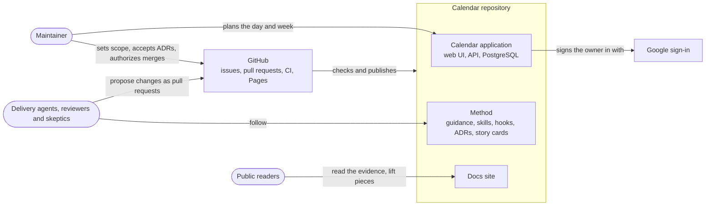
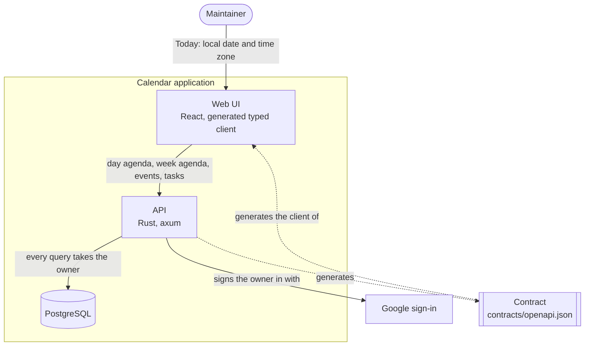
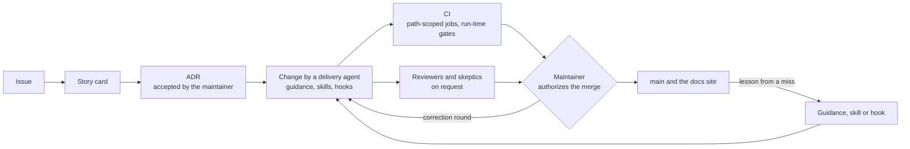

<!-- Generated from docs/narratives/calendar/ by the architecture-narrative-builder stitcher. Edit the parts and restitch; just check fails when this file differs from its parts. -->

# Calendar architecture narrative

Why Calendar is built the way it is: the problem it exists to solve, the forces that shaped it, and the architecture, decisions and risks that follow. Read it before you change the system, whether you are a person or an agent.

## Act 1: Setup

### The problem

Software written by AI coding agents cannot yet be trusted without close human checking. Calendar exists to develop and test the practices that make agent delivery dependable: the method. The planning application (one place to see the events and tasks of today and of the week) is the vehicle: a real product, small enough for one person to own, on which the method is exercised and its results recorded.

The maintainer wants three outcomes:

* **A reusable method others adopt.** The guidance, skills and hooks, copied together into another repository, work there; another repository adopts them, the maintainer reuses the method in the next project, and public readers engage with it.
* **Fewer corrections.** The median pull request written by a delivery agent merges after at most 2 correction rounds.
* **Personal depth** in agentic engineering, gained by doing the work.

A planning application relied on every day is not one of the outcomes.

### Why now

Coding agents became capable enough to deliver real changes, but the practices that make their output dependable are missing. If nothing is done, agent output stays something to distrust and recheck by hand, and the maintainer's own skill gap widens while the practice moves on. No team or employer need drives the work.

### Stakeholders

Agents propose; the maintainer decides.

| Role | Needs | Decides |
| --- | --- | --- |
| Maintainer | A method that produces changes worth merging with few correction rounds | Scope, the acceptance of every ADR, and the authorization of every merge |
| Delivery agent | Guidance, skills and hooks that say what to do and what is forbidden; records that outlive a session | Nothing: it designs, implements and posts on issues, and proposes |
| Reviewer and skeptic | A branch to review and findings to test | Nothing: they report findings and try to refute them before merge |
| Public reader | Evidence that the method works, and pieces that can be lifted out | Whether to copy the method, and which pieces |

### Users and scale

The application has one user, the maintainer, who signs in with one allow-listed Google account and uses it occasionally, to prove features rather than to plan every day. It runs locally only: the Azure infrastructure is defined in the repository but not deployed.

### Scope

In scope: the today and week views, events, tasks with a date or exact-time deadline, overdue triage, Google sign-in and the light and dark themes; and around the application, the docs site, the delivery dashboard and the agent tooling.

Out of scope: sharing and invitations, sync with other calendars, and native mobile apps. Recurring events are a possible future with no plan.

### Vocabulary

| Term | Meaning |
| --- | --- |
| Method | The guidance, skills, hooks and records that make agent delivery dependable |
| Maintainer | The repository's owner and only user |
| Delivery agent | An AI coding agent that designs and implements a change |
| Reviewer | An agent that reviews a branch for performance or security |
| Skeptic | An agent that tries to refute one review finding |
| Correction round | One maintainer request for changes on a delivery agent's pull request before it merges |
| ADR | A decision record in `docs/decisions` |
| Story card | The durable record of a story in `docs/stories` |
| Skill | A packaged procedure an agent follows |
| Harness | The program that runs an agent, such as Claude Code |
| Hook | A check the harness runs on an agent's actions |
| Bundle | The guidance, skills and hooks copied together into another repository |
| Baseline | The pinned run time a CI job is compared against |
| Event | A calendar entry with a time span or a whole day |
| Task | A todo with an optional date or exact-time deadline |
| Overdue | Said of a task whose deadline has passed and that is not completed |
| Day agenda, week agenda | The events and tasks of one day or one week, read as one snapshot |
| Today | The date and time zone the client supplies; the server never decides it |
| Owner | The signed-in account that events and tasks belong to |
| Contract | `contracts/openapi.json`, generated from the API and consumed by every UI |

## Act 2: Confrontation

### Constraints

Business:

* One maintainer, working in near full-time bursts with gaps. If time runs short, the method stays the priority and the application freezes.
* No employer, deadline, contract or regulator.

Technical, binding on any solution:

* **Agent rules.** Agents propose and never decide. Automation is written for Claude Code first ([ADR-0044](../decisions/0044-claude-first-agent-automation.md)) while the guidance stays readable by any agent. A hook stops a forbidden action before it happens.
* **Contract rules.** The contract is generated from the API and every UI consumes it. The client supplies Today. Every query for an event or a task takes the owner.

Not binding: the platform (GitHub, a public repository, Linux or WSL, Docker) and the stack with its version pins are choices, open to change; the backend has already moved from .NET to Rust.

Given up on purpose, because the only user is the maintainer and nothing is deployed: availability and operations, accessibility beyond readable contrast in both themes, and small screens.

### Challenges

* **Agents forget.** A delivery agent keeps nothing between sessions, so whatever it must know has to live in guidance, records or a hook.
* **One human decides.** The maintainer is the only reviewer and decider, and works in bursts. Every correction round spends the scarcest resource.
* **Time is subtle.** Day boundaries, time zones and daylight-saving changes are easy to get wrong in ways tests miss, and each rule exists in two forms: in the domain and in SQL.
* **The method must leave.** Practices proven here must work, as a bundle of guidance, skills and hooks, in a repository that shares none of this one's stack.

### Driving characteristics

| Characteristic | Business requirement | Target |
| --- | --- | --- |
| Verifiability | Fewer corrections: an agent's change is proven right by checks before the maintainer reads it | The median pull request written by a delivery agent merges after at most 2 correction rounds |
| Auditability | Public readers need evidence that the method works; agents propose and the maintainer decides | Every merged pull request links an issue or story card, and every significant decision has an ADR the maintainer accepted before its pull request merged |
| Portability of the method | A reusable method others adopt | The bundle of guidance, skills and hooks runs in another repository after only the edits its documentation lists |
| Delivery speed | One maintainer decides everything while agents wait on checks | No CI job slower than its pinned baseline, and full CI under 5 minutes at p90 |
| Correctness of time | Today is the date and time zone the client supplies | No event or task on the wrong day; a fixed matrix of time zones and daylight-saving transitions passes for the day agenda and week agenda, in the domain rules and in their SQL forms |

Where the targets stand: correction rounds are not measured yet (the counting rule is that any maintainer comment or review that forces a new push counts, and a fix for CI alone does not; the first baseline is the last 30 merged pull requests by delivery agents). The links and the ADR acceptance hold by convention only, because the maintainer authorizes every merge. Full CI was last measured before the Rust backend, at a median of 1:38 and a p90 of 2:07 over 40 pull request runs ([benchmark 0016](../benchmarks/0016-ci-jobs-by-changed-paths.md)); reviewer and skeptic runs happen outside CI. A missed target becomes an issue, its fix carries a test that fails without it, and the lesson goes into guidance, a skill or a hook.

Time correctness drives the design although the application is used only occasionally: it is the hardest correctness problem in the vehicle, so it is where the method is proven.

Candidates considered and set aside: security and privacy (with one user and nothing deployed it is hygiene, not a force on the design), evolvability (not a characteristic whose absence fails the project) and cost (nothing is deployed, so run cost forces nothing).

### Alternatives

#### How agents learn and are held to the rules

| Alternative | Strengths | Weaknesses against the driving characteristics |
| --- | --- | --- |
| Layered guidance (root and per-area files, skills) with hooks | Little text loaded in every session; a hook stops a forbidden action before it happens | Hooks run only under Claude Code, which narrows portability; more pieces for an adopter to take |
| Prose only in one root file | Simplest to copy; any agent reads it | Nothing is enforced, so the same mistakes return as correction rounds; the file grows with every lesson |
| Layered guidance with checks in lint and CI only | Works for every harness | A mistake is found after the work is done, at the cost of a CI round; a destructive local action is never stopped |

Trade-off, verifiability against portability: hooks cut correction rounds but tie the bundle to Claude Code and to this repository's paths. The panel suggested making each hook a thin wrapper over a check that CI also runs. The maintainer accepts the trade-off as it stands: the edits an adopter makes to each hook are a known cost.

#### Which agent harness the automation targets

| Alternative | Strengths | Weaknesses against the driving characteristics |
| --- | --- | --- |
| Claude Code first for automation; guidance neutral | Uses native hooks, skills and workflows; no twin of each automation to keep in step | An adopter on another harness follows the guidance by hand |
| Full neutrality: a hand-followable twin of every automation | Portable to any harness | Twice the text to maintain and verify; twins drift |
| A neutral automation layer of recipes and tools with an adapter per harness | Portable automation | An extra layer to build and test before any adopter exists |

Trade-off: the neutral layer is the strongest design for portability and the weakest use of the maintainer's time before any adopter exists. Adoption is therefore claimed for Claude Code adopters only.

#### Where decisions and stories are recorded

| Alternative | Strengths | Weaknesses against the driving characteristics |
| --- | --- | --- |
| ADRs and story cards as Markdown in the repository, published on the docs site | Records sit beside the code, are validated by tools, change in the same pull request and are public evidence | A card before delivery and an ADR acceptance add steps; an adopter takes the conventions too |
| No formal records: commit messages, pull request descriptions, README | No extra steps | An agent in a new session cannot find why; a reader has no evidence trail |
| An external wiki | Easy to edit | Outside the review and the checks; drifts from the code; not copied with the bundle |

Trade-off, auditability against portability: the record conventions are what the auditability target requires, and they add to what an adopter takes on. The direction is a minimal record kit in the bundle (the ADR and story card conventions with their validators), with the docs site and the architecture model optional. It is not built yet.

#### How the UI and the API agree

| Alternative | Strengths | Weaknesses against the driving characteristics |
| --- | --- | --- |
| A contract generated from the API and committed, with a generated typed client | A stale contract fails CI; a breaking change shows as a type error in every consumer | The contract follows the code rather than leading it |
| A hand-written contract with generated server stubs | The design is reviewed first | A second source to keep true; drift is found late |
| No contract: hand-written types and fetch calls | Nothing to generate | Nothing verifies that the two sides agree |

#### Who defines the day

| Alternative | Strengths | Weaknesses against the driving characteristics |
| --- | --- | --- |
| The client sends its local date and time zone; the server computes the window | The day is the user's wall-clock day; daylight-saving logic exists once, on the server, with tests | The client is trusted to send a truthful zone; the API's zone data and PostgreSQL's are updated separately |
| The client sends a UTC range | Simple for the server | Each client redoes the daylight-saving logic; whole-day items lose their local date |
| A time zone stored per user | Safe input | Wrong when the user travels; needs a setting before first use |
| The server's UTC day | Nothing to send | The wrong day for most zones |

#### How CI time is kept in check

| Alternative | Strengths | Weaknesses against the driving characteristics |
| --- | --- | --- |
| A run-time gate per job against a pinned baseline, with jobs run only for the paths they check | A regression fails the run that caused it; unaffected jobs do not run | Baselines must be re-pinned; a small regression under the margin passes; a skipped job is a check not run |
| No timing gate: benchmark records only | No false failures | Slowdowns accumulate unnoticed until someone measures |
| Every job on every change, with a fixed ceiling | Simple; everything is always checked | Waiting on jobs a change cannot affect; a ceiling catches only gross regressions |

Trade-off, delivery speed against verifiability and correctness of time: this was the panel's closest call. A job skipped for its paths is a check not run, for example when time-zone data or an image changes with no code path. The maintainer keeps path-scoped jobs and accepts the risk; the CI result job tells a skip by design from a missing job ([ADR-0046](../decisions/0046-run-ci-jobs-only-for-the-paths-they-check.md)).

#### How a change is reviewed before merge

| Alternative | Strengths | Weaknesses against the driving characteristics |
| --- | --- | --- |
| Reviewer agents on request, with a skeptic trying to refute each finding | Findings reach the maintainer already tested; false ones are dropped | Adds waiting time and token cost; runs only when asked |
| Maintainer review only | No waiting on agents | Every missed defect becomes a correction round |
| Reviewers without skeptics | Faster | Unrefuted findings include false ones, which waste the maintainer's attention |
| Review in CI on every pull request | Never forgotten | Lengthens every run and costs tokens on changes that do not need it |

Trade-off, verifiability against delivery speed: reviewers and skeptics add waiting outside CI, which the 5-minute target does not count.

## Act 3: Resolution

### The architecture

Calendar has two architectures that answer the same problem: the application, and the method that delivers it.

**The application** is small on purpose. The web UI calls the API through a typed client generated from the contract, and the API reads and writes PostgreSQL. The web UI sends Today, its local date and time zone, with every agenda request; the API computes the day's window and returns the day agenda or week agenda as one snapshot. The API signs the owner in with Google, and every query for an event or a task takes the owner. It runs locally only.

**The method** is a loop around every change. An issue becomes a story card; a significant decision becomes an ADR that the maintainer accepts. A delivery agent makes the change under layered guidance, skills and hooks. CI checks it, running only the jobs for the paths it touches and failing a job that runs slower than its baseline. On request, reviewers examine the branch and a skeptic tries to refute each finding. The maintainer authorizes the merge or asks for a correction round. A missed target becomes an issue, and its lesson goes back into guidance, a skill or a hook.

### Decisions

#### D1: Layered guidance with hooks

- **Context:** agents forget between sessions, and every repeated mistake is a correction round for the one human who decides.
- **Decision:** guidance in layers (a root file, one file per area, skills loaded when needed) and hooks that stop a forbidden action before it happens.
- **Consequences:** little text is loaded in every session, and a lesson can be enforced instead of restated. Hooks run only under Claude Code and name this repository's paths, so an adopter edits each one; the maintainer accepts that cost.
- **Status:** accepted ([ADR-0042](../decisions/0042-layered-agent-guidance-and-hooks.md)).
- **Rejected alternative:** prose only in one root file, because nothing is enforced and the file grows with every lesson; checks in lint and CI only, because a mistake is found after the work is done and a destructive local action is never stopped.

#### D2: Claude Code first for automation

- **Context:** the method must leave as a bundle, but one maintainer cannot keep every automation in two forms.
- **Decision:** new automation may target Claude Code only; the guidance files stay readable by any agent; the decision has a revisit trigger.
- **Consequences:** native hooks, skills and workflows, with no twins to drift. Only the guidance is neutral: the adoption claim covers Claude Code users only, and an agent on another harness follows the guidance by hand, without the hooks.
- **Status:** accepted ([ADR-0044](../decisions/0044-claude-first-agent-automation.md)).
- **Rejected alternative:** a hand-followable twin of every automation, because twins double the text and drift; a neutral automation layer with an adapter per harness, because it is an extra layer to build before any adopter exists.

#### D3: ADRs and story cards in the repository

- **Context:** public readers need evidence, an agent in a new session needs the reasons, and agents propose while the maintainer decides.
- **Decision:** every significant decision is an ADR and every story a story card, as Markdown in the repository, validated by tools and published on the docs site. The story card is the source of truth for a story.
- **Consequences:** records change in the same pull request as the code and are public. A card before delivery and an ADR acceptance add steps, and an adopter takes the conventions too.
- **Status:** accepted ([ADR-0000](../decisions/0000-use-markdown-architectural-decision-records.md), [ADR-0028](../decisions/0028-publish-user-stories-on-the-documentation-site.md)).
- **Rejected alternative:** no formal records, because a new session cannot find why and a reader has no trail; an external wiki, because it sits outside the review and the checks and is not copied with the bundle.

#### D4: A contract generated from the API

- **Context:** a change by a delivery agent must be proven right by checks before the maintainer reads it.
- **Decision:** the API generates the contract, which is committed; the web UI's typed client is generated from it.
- **Consequences:** a stale contract fails CI and a breaking change is a type error in every consumer. The contract follows the code rather than leading it.
- **Status:** accepted ([ADR-0004](../decisions/0004-openapi-contract-and-generated-client.md)).
- **Rejected alternative:** a hand-written contract with generated server stubs, because a second source drifts and the drift is found late; no contract, because nothing verifies that the two sides agree.

#### D5: The client defines the day

- **Context:** time is subtle, and it is where the method is proven.
- **Decision:** the client sends its local date and time zone; the API computes the window once and applies the same inclusion rules to the day agenda and the week agenda. The server never decides what day it is. A missing or invalid date or zone is rejected.
- **Consequences:** the day is the user's wall-clock day, and the daylight-saving logic exists once, with tests; domain tests check that the SQL forms agree with the domain rules. The client is trusted to send a truthful zone, and the API's time-zone data and PostgreSQL's are updated separately.
- **Status:** accepted ([ADR-0021](../decisions/0021-client-supplied-date-and-time-zone-define-the-day.md), [ADR-0024](../decisions/0024-week-agenda-endpoint-on-range-based-internals.md), [ADR-0057](../decisions/0057-chrono-time-types-for-the-rust-backend.md)).
- **Rejected alternative:** a UTC range from the client, because each client redoes the daylight-saving logic and whole-day items lose their local date; a stored time zone, because it is wrong when the user travels; the server's UTC day, because it is the wrong day for most zones.

#### D6: Run-time gates and path-scoped jobs in CI

- **Context:** agents wait on checks in every round, and the maintainer's attention is the scarce resource.
- **Decision:** each CI job is gated against a pinned run-time baseline, and a job runs only for the paths it checks; a CI result job runs on every change and tells a skip by design from a missing job.
- **Consequences:** a regression fails the run that caused it, and unaffected jobs cost nothing. A skipped job is a check not run, baselines must be re-pinned, and a regression smaller than the margin passes. A gate per job does not bound the total: full CI can grow while every job passes. The maintainer accepts the risk of a wrong skip.
- **Status:** accepted ([ADR-0045](../decisions/0045-run-time-regression-gates-for-ci-jobs.md), [ADR-0046](../decisions/0046-run-ci-jobs-only-for-the-paths-they-check.md)).
- **Rejected alternative:** no gate, because slowdowns accumulate unnoticed; every job on every change with a fixed ceiling, because of the waiting on jobs a change cannot affect. The panel rated this last one almost level with the decision.

#### D7: Review before merge, with a skeptic per finding

- **Context:** every defect the maintainer finds is a correction round; every false finding wastes the same attention.
- **Decision:** on request, reviewers examine a branch for performance and for security, and a skeptic tries to refute each finding before it reaches the maintainer.
- **Consequences:** findings arrive already tested and refuted ones stay visible. The review adds waiting and token cost outside CI. It runs only when asked, so it proves nothing on a pull request where nobody asked.
- **Status:** implemented, with no ADR, which is a known exception to the auditability target ([story 0035](../stories/0035-review-before-merge-with-a-workflow-and-a-skeptic-per-finding.md)).
- **Rejected alternative:** maintainer review only, because every missed defect becomes a correction round; reviewers without skeptics, because false findings reach the maintainer; review in CI on every pull request, because it lengthens every run and costs tokens on changes that do not need it.

### How the driving characteristics are met

| Characteristic | Target | How the architecture meets it |
| --- | --- | --- |
| Verifiability | The median pull request written by a delivery agent merges after at most 2 correction rounds | D1 and D4 check every change before the maintainer reads it, and D7 checks the changes it is requested for. What causes correction rounds today is not known, so whether these decisions address the main cause is not known either, and the outcome is not measured yet: risk 1 and the checkpoint. |
| Auditability | Every merged pull request links an issue or story card; every significant decision has an ADR accepted before its pull request merged | D3 gives the records and the loop gives the order. A hook checks the closing keyword on the pull request that completes a story card; nothing checks a link on every pull request or the status of an ADR at merge. The target is already missed once: D7 merged without an ADR. Risk 2 and the checkpoint. |
| Portability of the method | The bundle runs in another repository after only the edits its documentation lists | D2 makes only the guidance neutral to the harness. The skills and hooks of D1 run under Claude Code and need edits for another repository, and those edits are not listed yet. The bundle has never been copied; the next project is the test: risks 3, 4 and 11. |
| Delivery speed | No CI job slower than its pinned baseline; full CI under 5 minutes at p90 | D6 gates each job, which does not bound the total. The last measurement of full CI, before the Rust backend, was a p90 of 2:07; it has not been repeated since: risk 6 and the checkpoint. |
| Correctness of time | No event or task on the wrong day; the matrix passes in the domain rules and their SQL forms | D5, with tests for daylight-saving days and for agreement between the two forms. The size of the matrix is an open question. Risks 5, 7 and 12 cover what the tests do not. |

### Risks

| # | Risk | Likelihood | Impact | Mitigation |
| --- | --- | --- | --- | --- |
| 1 | Correction rounds are not measured, so the main target cannot be shown met or missed | high | high | The checkpoint, owned by the maintainer |
| 2 | A pull request merges without a link, or with an ADR still proposed, because both hold by convention only | medium | medium | The maintainer authorizes every merge; the ADR and issue sweeps find drift afterwards; the checkpoint measures the link rate; a check is an open question |
| 3 | Hooks and workflows run only under Claude Code, so a change in that harness or an adopter on another one loses the enforcement | medium | high | The guidance stays readable by any agent; ADR-0044 has a revisit trigger |
| 4 | The bundle has never been copied into another repository, and the record kit is not built, so portability is unproven | high | high | The maintainer's reuse of the bundle in the next project is the test; every edit made there is listed. Nothing verifies it before that |
| 5 | A job skipped for its paths hides a regression, for example a change of time-zone data or of an image | low | high | The CI result job tells a skip by design from a missing job; accepted by the maintainer |
| 6 | Full CI has not been measured since the Rust backend and may already exceed 5 minutes at p90 | medium | medium | The checkpoint; a p90 above 5 minutes opens a `performance` issue before any baseline is re-pinned |
| 7 | The API's time-zone data and PostgreSQL's diverge, so a domain rule and its SQL form disagree | low | medium | The agreement tests; update both together |
| 8 | The wait for reviewers and skeptics, outside CI, grows unmeasured, or the review is not requested | medium | medium | Measure it with the CI figures; the handover asks for the review before a merge |
| 9 | The maintainer's time stops, and with it every decision | medium | high | The method comes first and the application freezes; the records are public and complete enough to resume from |
| 10 | No public reader engages or adopts, so the first outcome is never observed | high | medium | The maintainer's reuse in the next project is the adoption that can be controlled |
| 11 | What the bundle needs (the tools' runtimes, the task runner, the version pins) is not documented for an adopter, so the edits its documentation lists are incomplete | high | medium | List the prerequisites when the minimal record kit is decided; the next project shows what was missed |
| 12 | A wrong client clock, a Today gone stale across midnight or a zone the API does not know gives the wrong day view with no signal | medium | medium | The API rejects an invalid zone; the web UI recomputes Today at local midnight and on focus ([ADR-0021](../decisions/0021-client-supplied-date-and-time-zone-define-the-day.md)); a truthful client is otherwise trusted |

#### The checkpoint

Before the next story card opens, the maintainer samples the last 30 merged pull requests by delivery agents once, for the median of correction rounds and for the share that link an issue or story card, and measures the p90 of full CI. A median above 2 or a p90 above 5 minutes opens an issue before any other work starts, and its lesson goes into guidance, a skill or a hook. The sample is repeated every 30 merged pull requests by delivery agents.

### Open questions

The maintainer decides each of these when it next blocks work; none has a date.

- Should a CI check fail a pull request without an issue or story card link, and stop a proposed ADR from merging?
- Which records form the minimal record kit of the bundle, with the docs site and the architecture model optional?
- Does review before merge deserve an ADR of its own?
- How large is the time matrix (zones, daylight-saving transitions, kinds of event and task, day agenda and week agenda), and should the time tests run on every change instead of only for their paths?
- What counts as the bundle running in another repository: which prerequisites, how many edits, and which task proves it?
- What makes a decision significant enough to need an ADR?
- What does the method cost: the wait and the tokens for each reviewed pull request, and the maintainer's minutes for each correction round?

## Assumptions

No assumption was needed: the maintainer answered every question of the interview, and what is unknown is stated as a risk or an open question in Act 3.

## Appendix: Expert panel

The narrative was reviewed by a panel of expert agents, one per driving characteristic plus an end-user and a business expert. The panel asked questions after Act 1, rated the 23 alternatives of Act 2 and reviewed Act 3. In Act 2 the chosen alternative had the highest average rating for every decision; the closest was CI time, where path-scoped jobs with run-time gates scored 2.1 of 3 against 2.0 for every job on every change.

| Expert | Verdict | Objections and their outcome |
| --- | --- | --- |
| Verifiability | object | The decisions are credited with proving a change, without evidence of what causes correction rounds, and review is optional: revision (characteristics table, D7). The baseline is a single count with no source, repeat or response: revision (the checkpoint; risk 1 impact raised to high). Nobody notices a missed target: revision (the checkpoint). |
| Auditability | object | "Nothing enforces" ignored the hook on the completing pull request, and the likelihood had no figure: revision (characteristics table; the checkpoint measures the link rate). D7 merged without an ADR and "significant" is undefined: revision (known exception) and open question. The status of ADR-0057: checked, accepted, no change. |
| Portability of the method | object | D2 was credited with making the bundle portable: revision (characteristics table, D2). The portability test has no pass criterion: open question. The bundle's prerequisites are undocumented: risk 11. |
| Delivery speed | object | A missed ceiling was rated low impact, with re-pinning as the mitigation: revision (risk 6 impact raised to medium; the checkpoint). Per-job gates cannot bound total CI time: revision (D6, characteristics table). The wait for reviewers has no metric: open question (the cost of the method). |
| Correctness of time | object | The matrix is not sized: open question. Time tests can be skipped by design: open question. Divergence of time-zone data rated low likelihood: declined by the maintainer, the rating stands (risk 7). No risk for a wrong clock, a stale Today or an unknown zone: risk 12. |
| End user | sign-off | None. |
| Business | object | No risk had a checkpoint: revision (the checkpoint, tied to the next story card). The limit to Claude Code was not tied to adoption: revision (D2). The cost of the method is not sized: open question. |
