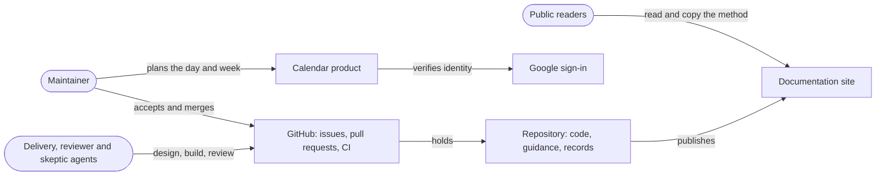
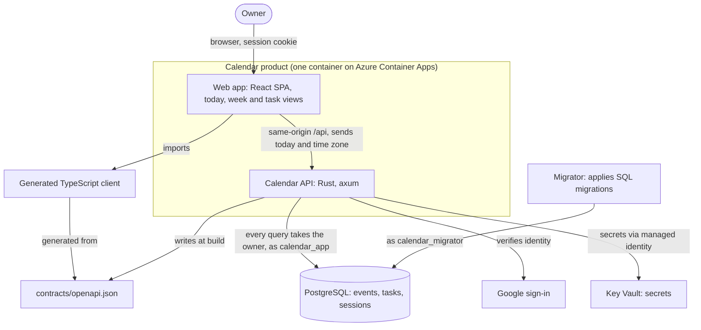
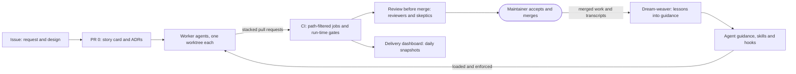

# Calendar

Architecture narrative for new contributors, human and agent

---

# Act 1: Two problems, one project

- **Planning:** one view of today's and this week's events and tasks, including overdue ones, in the owner's own time zone
- **Engineering:** make AI-assisted software engineering dependable: decided before built, checked before merged, improved when it goes wrong
- When they pull apart, **the method wins**: the product is the vehicle
- **Why now:** agentic coding became useful in 2026, and the practices to trust it do not exist yet

---

# Success means a reusable method

| Sign | Measure |
| --- | --- |
| A skill travels | A copied skill folder works without this repository's tooling |
| The method is adopted | Another repository adopts the guidance, skills and hooks |
| Lessons stick | Repeated lessons fall month over month |
| Agent work merges clean | Median agent pull request: at most 2 correction rounds |

---

# Who is involved

| Role | Decides |
| --- | --- |
| Maintainer | Scope, which ADRs are accepted, every merge |
| Delivery agents | Nothing alone: they propose, build and report |
| Reviewer and skeptic agents | Whether a finding stands before it reaches the maintainer |
| Public readers | Whether the method is worth copying |

One product user: the maintainer. Staging on Azure; production not live.

---

# Context

---

# Act 2: Constraints and challenges

**Binding:** agent rules (Claude Code first, hooks, acceptance) and contract rules (generated contract, client supplies today, owner on every query)

- Agents forget between sessions
- One human reviewer, working in bursts
- Time is subtle: floating dates, daylight saving, the same rules in Rust and SQL
- Stacks change underneath: .NET to Rust, .NET to Deno

---

# Driving characteristics

| Characteristic | Target |
| --- | --- |
| Verifiability | Median agent pull request merges after at most 2 correction rounds |
| Delivery speed | No job over its baseline; full CI under 15 minutes at p90 |
| Correctness of time | Zero day-boundary defects; zone and DST matrix in domain and SQL |
| Security and privacy | No cross-owner access, tested per endpoint; no leaks to the public repository |

Set aside: evolvability, portability, cost

---

# Act 3: The product

---

# Act 3: The method

---

# Decisions

- **D1** Generated contract and client, not hand-written types
- **D2** The client decides what day it is, not a stored zone
- **D3** Every query takes an `OwnerId`; row-level security still open (ADR-0041 drifted)
- **D4** Rust replacing .NET in place, not route by route
- **D5** Story cards and ADRs as the source of truth, with PR 0
- **D6** Layered guidance with enforcing hooks, not lint-only checks
- **D7** Reviewers and skeptics before merge, on code pull requests
- **D8** Path-filtered CI with run-time gates and a dashboard

---

# How the targets are met

| Characteristic | Status |
| --- | --- |
| Verifiability | Mechanism in place; outcome **not measured** yet |
| Delivery speed | Met: slowest job p90 229 s, no run over about 5 minutes (12 Nov 2026) |
| Correctness of time | Matrix passes in domain and SQL forms |
| Security and privacy | Owner on every query, ownership tests, hooks, Key Vault |

---

# Top risks and open questions

| Risk | Likelihood | Impact |
| --- | --- | --- |
| One maintainer is the only reviewer | high | medium |
| Prompt injection steers an agent | medium | high |
| Records drift from the code | high | medium |
| Hooks protect Claude Code sessions only | medium | high |

**Open:** row-level security · measuring correction rounds · superseding ADR-0041
