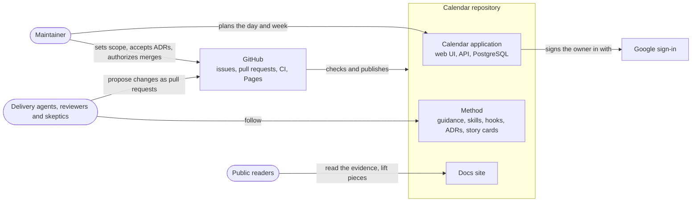
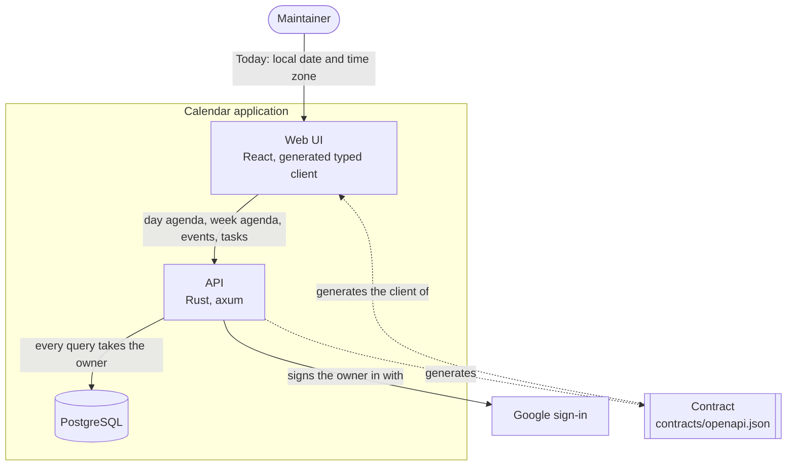
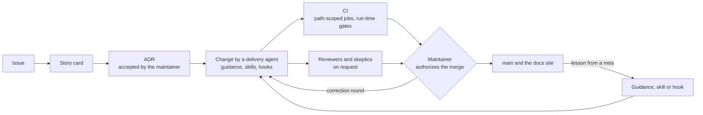

# Calendar

Architecture narrative for new contributors, human and agent

---

# Act 1: The problem

- Software written by AI coding agents cannot yet be trusted without close human checking
- Calendar develops and tests the **method** that makes agent delivery dependable
- The planning application is the **vehicle**: real, and small enough for one person to own
- **Why now:** agents became capable enough, but the practices are missing, and the maintainer's skill gap widens without hands-on work

---

# Outcomes, and who decides

- A reusable method others adopt: the bundle works in another repository
- The median pull request by a delivery agent merges after **at most 2 correction rounds**
- Personal depth in agentic engineering

| Role | Decides |
| --- | --- |
| Maintainer | Scope, every ADR, every merge |
| Delivery agent | Nothing: it proposes |
| Reviewer and skeptic | Nothing: they report and refute findings |
| Public reader | Whether to copy the method, and which pieces |

---

# Context

One user, the maintainer, occasionally. Local only. Out of scope: sharing, sync with other calendars, native mobile apps.

---

# Act 2: Constraints and challenges

**Binding rules**

- Agent rules: agents propose and never decide; automation for Claude Code first; hooks stop forbidden actions
- Contract rules: a generated contract; the client supplies Today; every query takes the owner

**Challenges**

- Agents forget between sessions
- One human decides, in bursts
- Time is subtle, in two forms: domain and SQL
- The method must leave, as a bundle

---

# Driving characteristics

| Characteristic | Target |
| --- | --- |
| Verifiability | Median of at most 2 correction rounds |
| Auditability | Every merged pull request links an issue or story card; every significant decision has an accepted ADR first |
| Portability of the method | The bundle runs elsewhere after only its documented edits |
| Delivery speed | No CI job over its baseline; full CI under 5 minutes at p90 |
| Correctness of time | No event or task on the wrong day; the matrix passes in domain and SQL forms |

Set aside: security and privacy, evolvability, cost.

---

# The closest calls

- **CI time:** path-scoped jobs with run-time gates (2.1 of 3) against every job on every change (2.0). A skipped job is a check not run; the risk is accepted
- **Hooks against portability:** hooks cut correction rounds but tie the bundle to Claude Code and to this repository's paths; accepted
- **Records against portability:** the records are the evidence, and weight for an adopter; the direction is a minimal record kit

---

# Act 3: The application

---

# Act 3: The method

---

# Decisions

- **D1** Layered guidance with hooks, over prose in one file
- **D2** Claude Code first for automation, over a twin of every automation
- **D3** ADRs and story cards in the repository, over no formal records
- **D4** A contract generated from the API, over a hand-written one
- **D5** The client defines the day, over a UTC range or a stored zone
- **D6** Run-time gates and path-scoped jobs, over every job on every change
- **D7** Review before merge with a skeptic per finding, over maintainer review only

---

# Where the targets stand

- Correction rounds: **not measured yet**
- Links and ADR acceptance: **by convention only**; review before merge has no ADR
- The bundle: **never copied**; the next project is the test
- Full CI: p90 of 2:07 **before the Rust backend**, not measured since

**The checkpoint:** before the next story card opens, sample the last 30 merged pull requests by delivery agents and measure full CI. A median above 2 or a p90 above 5 minutes opens an issue first.

---

# Top risks and open questions

| Risk | Likelihood | Impact |
| --- | --- | --- |
| Portability is unproven | high | high |
| Correction rounds are unmeasured | high | high |
| Enforcement depends on Claude Code | medium | high |
| The maintainer's time stops | medium | high |
| A skipped job hides a regression | low | high |

Open: a link and ADR check in CI, the minimal record kit, an ADR for review before merge, the size of the time matrix, what counts as the bundle running, what makes a decision significant, what the method costs.
